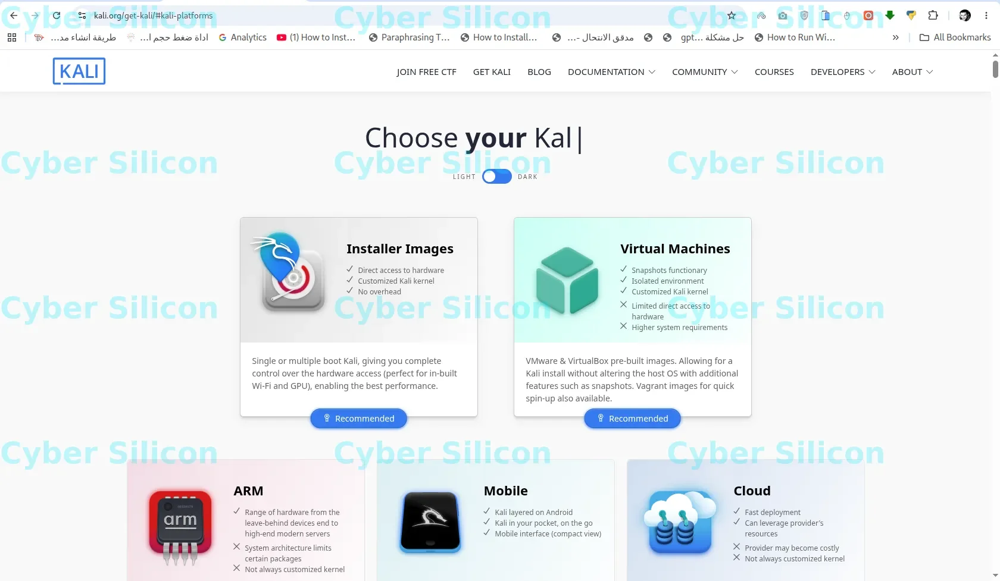
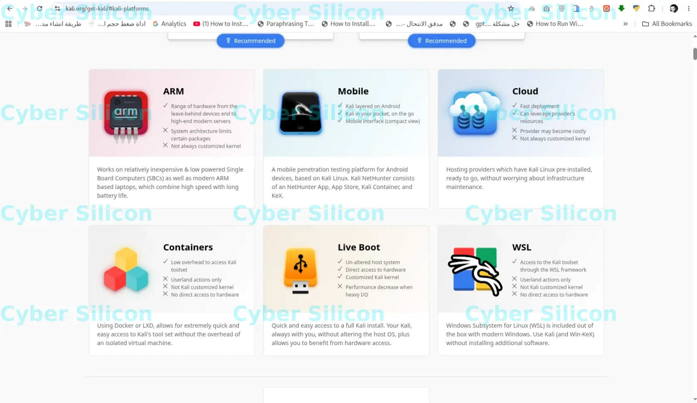
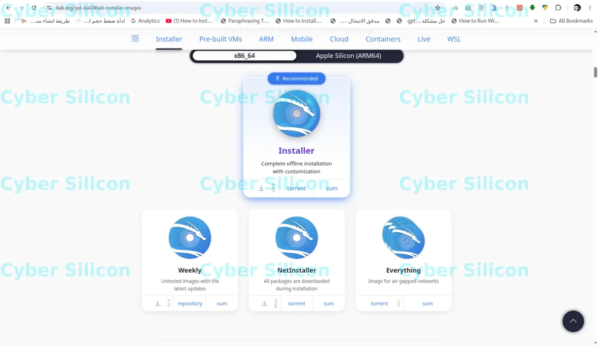
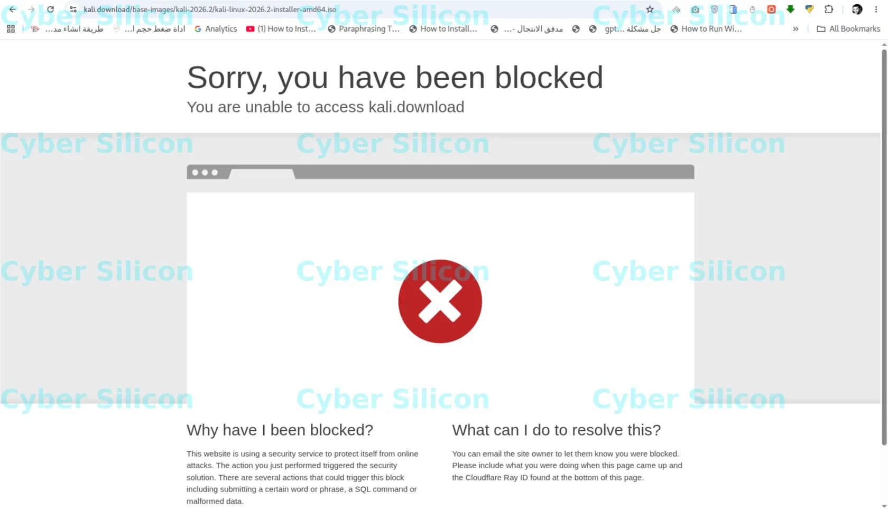
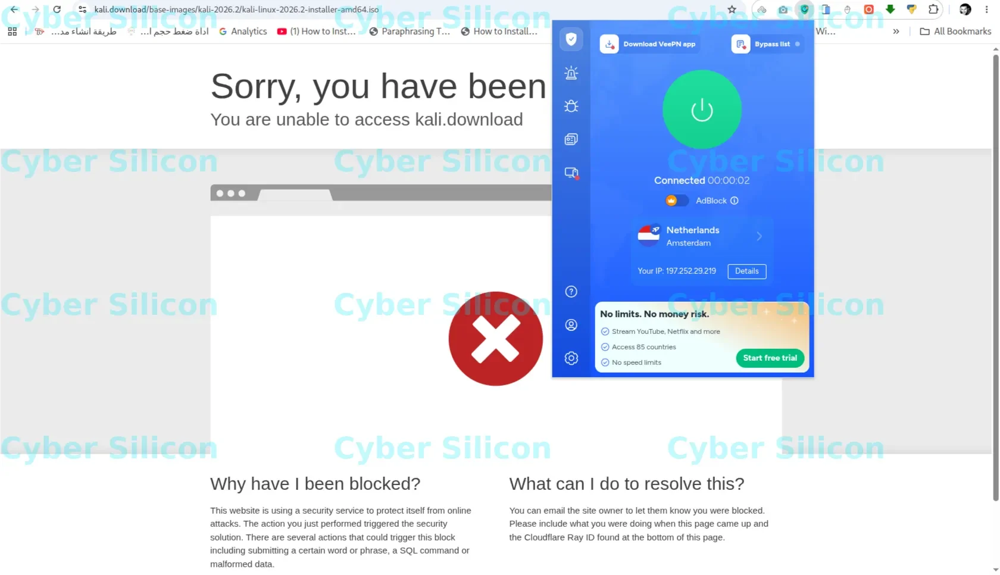

# [سلسلة Kali Linux - الدرس 1] الشرح الشامل لاختيار وتحميل النسخة المناسبة لجهازك

أهلاً بكم في أولى دروس **سلسلة تعلم واحتراف نظام Kali Linux من الصفر** مقدمة لكم من **Cyber Silicon**! 🚀

![[IMG_20261005_052936.webp]]

عند فتح الصفحة الرسمية لتنزيل Kali Linux (`kali.org/get-kali`)، ستواجه عدة منصات وخيارات قد تجعل المبتدئ يحتار في اختيار النسخة الملائمة لبيئته وهدفه. في هذا الدرس، سنقوم بشرح وتفكيك كل منصة خياراً بخيار، بالإضافة إلى مقارنة خيارات التثبيت المختلفة.

---

## 📍 أولاً: شرح المنصات والبيئات المتاحة (Choose your Kali)

تتيح شركة Offensive Security نظام Kali Linux على 8 منصات رئيسة لتناسب كافة الاستخدامات:

### 1. Installer Images (صور التثبيت الكاملة - الموصى بها)
* **الاستخدام:** للتثبيت المباشر كنظام أساسي بجانب ويندوز (Dual Boot) أو داخل البرامج الوهمية.
* **المميزات:** وصول مباشر للعتاد (Hardware)، أداء عالي جداً، وإمكانية تخصيص الواجهة والبرامج أثناء التثبيت.

### 2. Virtual Machines (الأنظمة الوهمية الجاهزة)
* **الاستخدام:** للعمل الفوري على برامج مثل VirtualBox و VMware.
* **المميزات:** ملف محمل ومجهز بالكامل، يعمل بضغط زر دون الحاجة لخطوات تثبيت، مع دعم ميزة اللقطات السريعة (Snapshots).

### 3. ARM (أجهزة المعالجات الموفرة للطاقة)
* **الاستخدام:** للأجهزة الذكية اللوحية وبطاقات Raspberry Pi وأجهزة اللابتوب الحديثة التي تعمل بمعالجات ARM.

### 4. Mobile (أجهزة الهواتف الذكية - Kali NetHunter)
* **الاستخدام:** لتشغيل Kali Linux على هواتف أندرويد (تطبيق NetHunter و NetHunter App Store و Kex).
* **المميزات:** بيئة اختبار اختراق كاملة ومحمولة في جيبك.

### 5. Cloud (البيئات السحابية)
* **الاستخدام:** للتثبيت على خوادم AWS و Azure و Google Cloud.
* **المميزات:** نشر سريع على سيرفرات عالية الأداء للاختبارات عن بُعد.

### 6. Containers (الحاويات)
* **الاستخدام:** لتشغيل أدوات Kali عبر Docker أو LXD.
* **المميزات:** خفيفة جداً وعزل تام للأدوات بدون استهلاك موارد النظام الوهمي الكامل.

### 7. Live Boot (التشغيل المباشر من الفلاشة)
* **الاستخدام:** الاقلاع المباشر من فلاش USB دون التعديل على القرص الصلب أو نظام التشغيل الأصلي.
* **المميزات:** الحفاظ على خصوصية النظام وعدم ترك أي أثر على الجهاز المستضيف.

### 8. WSL (نظام ويندوز الفرعي للينكس)
* **الاستخدام:** تشغيل أدوات Kali Linux مباشرة داخل بيئة Windows 10/11 عبر Win-KeX.
* **المميزات:** سرعة وصول لأدوات السطر البرمجي دون الحاجة لبرامج وهمية خارجية.

---

## ⚙️ ثانياً: اختيار المعمارية واختيارات Installer Images

إذا اخترت قسم **Installer Images**، فستظهر لك الخيارات التالية بناءً على نوع معالج جهازك:

* **x86_64:** للأجهزة القياسية والحواسيب المحمولة والمكتبية المتوافقة مع معالجات Intel و AMD.
* **Apple Silicon (ARM64):** مخصصة لأجهزة ماك الحديثة المزودة بشرائح Apple (M1, M2, M3, M4).

### خيارات التنزيل داخل قسْم `Installer`:

| اسم النسخة | الحجم التقريبي | الوصف والاستخدام |
| :--- | :--- | :--- |
| **Installer (Recommended)** | ~ 4.4 GB | النسخة القياسية الكاملة الشاملة لجميع حزم الأدوات الأساسية والواجهات بدون الحاجة للإنترنت أثناء التثبيت. |
| **Weekly** | ~ 4.7 GB | نسخة أسبوعية تحتوي على آخر التحديثات والحزم التجريبية. |
| **NetInstaller** | ~ 743 MB | نسخة خفيفة جداً، تقوم بتنزيل جميع الأدوات والبرامج من الإنترنت أثناء عملية التثبيت. |
| **Everything** | ~ 13 GB | تحتوي على كافة أدوات Kali Linux المتوفرة في المستودعات الرسمية (للمشروعات المعزولة عن الإنترنت air-gapped). |

---

## 📥 روابط التحميل المباشرة

* 🌐 **الصفحة الرسمية لاختيار المنصات:** [kali.org/get-kali](https://www.kali.org/get-kali/)
* 📦 **تحميل Installer Images المباشر:** [kali.org/get-kali/#kali-installer-images](https://www.kali.org/get-kali/#kali-installer-images)
* 💻 **تحميل Virtual Machines المباشر:** [kali.org/get-kali/#kali-virtual-machines](https://www.kali.org/get-kali/#kali-virtual-machines)

---

## ⚠️ حل مشكلة الحظر Blocked Error أثناء فتح الموقع

في حال ظهور خطأ الحظر مثل:
`Sorry, you have been blocked` أو `Cloudflare Access Denied`

* **السبب:** تقييد جغرافي أو حظر على عنوان الـ IP الخاص بك من قبل خوادم الحماية.

* **الحل:** قم بتشغيل تطبيق **VPN** وربطه بسيرفر أوروبي أو أمريكي، ثم قم بإعادة تحميل الصفحة وستعمل رابط التحميلات والموقع فوراً.

---

### 🔗 التنقل بين دروس السلسلة

* **الدرس السابق 👈:** لا يوجد (هذا هو الدرس الأول في السلسلة).
* **الدرس التالي 👈:** [[سلسلة Kali Linux - الدرس 2] تحميل برنامج VirtualBox و حزمة Extension Pack](https://cyber-silicon.github.io/kali%20linux/virtualbox/cyber%20silicon/2026/11/03/lesson-2-%D8%B3%D9%84%D8%B3%D9%84%D8%A9-kali-linux-%D8%A7%D9%84%D8%AF%D8%B1%D8%B3-2-%D8%AA%D8%AD%D9%85%D9%8A%D9%84-%D8%A8%D8%B1%D9%86%D8%A7%D9%85%D8%AC-virtualbox-%D9%88-%D8%AD%D8%B2%D9%85%D8%A9-exte.html)