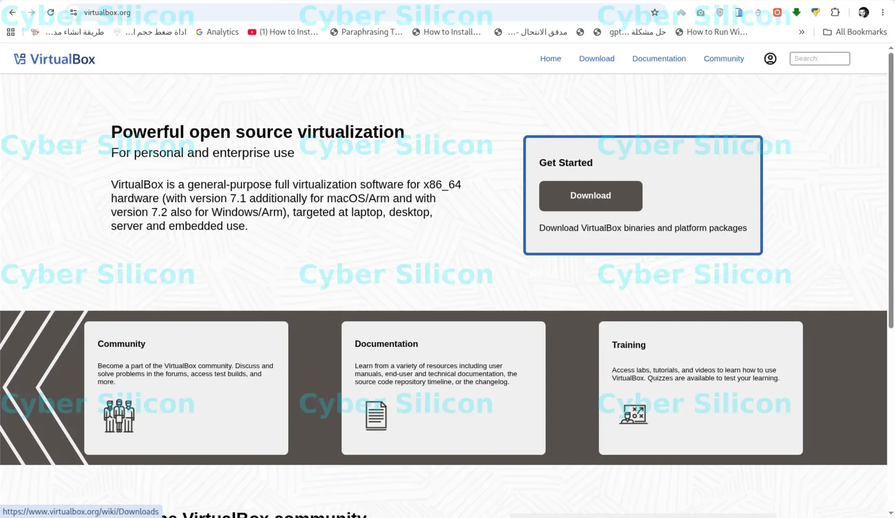
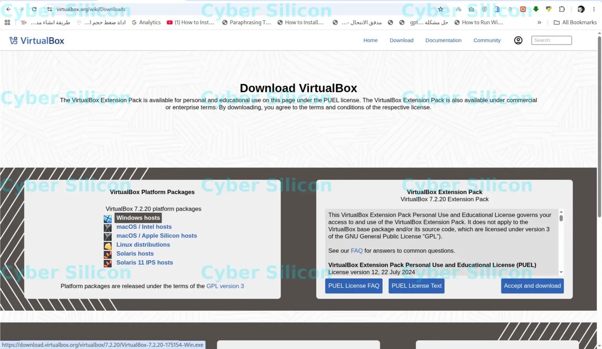

![[سلسلة Kali Linux - الدرس 2] تحميل برنامج VirtualBox و حزمة Extension Pack](https://p16-common-sign.tiktokcdn.com/tos-alisg-p-0037/okIbJUyEdCcMPArVziQALFEDp4DE2yDyjfceeg~tplv-tiktokx-cropcenter-q:300:400:q70.webp?dr=14782&refresh_token=14a33181&x-expires=1793635200&x-signature=PBkQQgI49gLkObHz2PgAVJ0NYGs%3D&t=bacd0480&ps=933b5bde&shp=d05b14bd&shcp=8aecc5ac&idc=my2&s=TIKTOK_FOR_DEVELOPER&sc=cover&biz_tag=tt_video){: .center-image }

# [سلسلة Kali Linux - الدرس 2] كيفية تحميل برنامج VirtualBox وحزمة Extension Pack

مرحباً بكم في الدرس الثاني من **سلسلة تعلم واحتراف نظام Kali Linux من الصفر** المقدمة من قناة **Cyber Silicon**! 💻🚀

بعد أن تعرّفنا في الدرس الأول على كيفية اختيار وتحميل نسخة Kali Linux المناسبة، تأتي الخطوة الثانية وهي تجهيز البيئة الوهمية (Virtual Environment) التي سنقوم بتثبيت النظام عليها باستخدام برنامج **Oracle VM VirtualBox**.

---

### 📌 ما هو برنامج VirtualBox ولماذا نحتاجه؟

برنامج **VirtualBox** هو أداة مجانية ومفتوحة المصدر تتيح لك إنشاء حواسيب وهمية (Virtual Machines) داخل نظامك الحالي. تتيح لك هذه البيئة تشغيل نظام Kali Linux وتجربة أدواته بأمان تام ودون أي تأثير على ملفاتك أو نظام تشغيلك الأساسي.

---

### 📥 أولاً: التوجه إلى الصفحة الرسمية للتحميل

1. افتح المتصفح وتوجه إلى الموقع الرسمي: **`virtualbox.org`**

2. اضغط على زر **Download** في الصفحة الرئيسية أو قائمة **Downloads** العلوية.

---

### ⚙️ ثانياً: شرح النسخ والحزم المتاحة (VirtualBox Platform Packages)

عند فتح صفحة التنزيلات، ستجد قسم **VirtualBox Platform Packages** والذي يوفر ملف التثبيت المخصص لكل نظام تشغيل:

* **Windows hosts:** مخصصة لأجهزة الكمبيوتر التي تعمل بنظام **Windows** (مثل Windows 10 أو Windows 11).
* **macOS / Intel hosts:** مخصصة لأجهزة أبل ماك (MacBook / iMac) القديمة التي تعمل بمعالجات **Intel**.
* **macOS / Apple Silicon hosts:** مخصصة لأجهزة أبل ماك الحديثة المزودة بشرائح أبل **Apple Silicon** (M1, M2, M3, M4).
* **Linux distributions:** مخصصة لأنظمة لينكس المختلفة مثل Ubuntu, Debian, Fedora, RHEL, و openSUSE.
* **Solaris hosts / Solaris 11 IPS hosts:** مخصصة لأنظمة Oracle Solaris على بيئات الخوادم والمؤسسات.

---

### 🧩 ثالثاً: حزمة التوسعة (VirtualBox Extension Pack)

لضمان الأداء الأفضل ولتفعيل كامل خصائص البيئة الوهمية، يجب تحميل حزمة **Extension Pack**.

**مميزات حزمة Extension Pack:**
* دعم منافذ الأجهزة والأجهزة الموصولة عبر USB 2.0 و USB 3.0.
* دعم التشفير للأقراص الوهمية (Virtual Disk Encryption).
* دعم ميزة NVMe لتسريع أداء التخزين الوهمي.
* إمكانية التحكم عن بعد عبر RDP (VirtualBox Remote Desktop Protocol).

**طريقة التحميل:** من قسم **VirtualBox Extension Pack**، اضغط على زر **Accept and download** للموافقة على الترخيص وتنزيل الملف.

---

## 🔗 روابط التحميل المباشرة

* 🌐 **صفحة التحميل الرئيسية:** [virtualbox.org/wiki/Downloads](https://www.virtualbox.org/wiki/Downloads)
* 💻 **تحميل VirtualBox لنظام Windows:** [VirtualBox Windows Installer](https://download.virtualbox.org/virtualbox/7.2.20/VirtualBox-7.2.20-175154-Win.exe)
* 🧩 **تحميل حزمة Extension Pack:** [VirtualBox Extension Pack All Platforms](https://download.virtualbox.org/virtualbox/7.2.20/Oracle_VirtualBox_Extension_Pack-7.2.20.vbox-extpack)

---

💡 **الخطوة القادمة:** في الدرس القادم سنقوم بشرح تثبيت برنامج VirtualBox وإضافة حزمة Extension Pack وضبط إعدادات البيئة الوهمية استعداداً لتثبيت نظام Kali Linux!

---

### 🔗 التنقل بين دروس السلسلة

* **الدرس السابق 👈:** [الدرس 1](https://cyber-silicon.github.io/kali%20linux/cyber%20silicon/%D8%AF%D8%B1%D9%88%D8%B3%20%D9%88%D8%AA%D9%82%D9%86%D9%8A%D8%A7%D8%AA/2026/11/03/lesson-1-%D8%B3%D9%84%D8%B3%D9%84%D8%A9-kali-linux-%D8%A7%D9%84%D8%AF%D8%B1%D8%B3-1-%D8%A7%D9%84%D8%B4%D8%B1%D8%AD-%D8%A7%D9%84%D8%B4%D8%A7%D9%85%D9%84-%D9%84%D8%A7%D8%AE%D8%AA%D9%8A%D8%A7%D8%B1-%D9%88%D8%AA%D8%AD%D9%85%D9%8A%D9%84-%D9%86%D8%B3%D8%AE%D8%A9-ka.html)
* **الدرس التالي 👈:** سيُضاف عند نشر الدرس التالي

<iframe src="https://www.tiktok.com/player/v1/7666519245269847313?autoplay=0" style="width:100%;max-width:340px;height:580px;border:none;border-radius:12px;" allow="fullscreen" loading="lazy"></iframe>

> 📹 **شاهد الشرح الكامل على TikTok:** [https://www.tiktok.com/@cyber_silicon/video/7666519245269847313?utm_campaign=tt4d_open_api&utm_source=sbawotogm6mg76anhw](https://www.tiktok.com/@cyber_silicon/video/7666519245269847313?utm_campaign=tt4d_open_api&utm_source=sbawotogm6mg76anhw)