![سلسلة Kali Linux - الدرس 3] تثبيت VirtualBox وتجهيز الـ Virtual Machine](/assets/images/tiktok-cover-سلسلة-kali-linux-الد.jpg){: .center-image }

# [سلسلة Kali Linux - الدرس 3] تثبيت VirtualBox وتجهيز الـ Virtual Machine

مرحباً بكم في الدرس الثالث من **سلسلة تعلم واحتراف نظام Kali Linux من الصفر** المقدمة من قناة **Cyber Silicon**! 💻🐉

نصل اليوم إلى الخطوة الحاسمة في تجهيز مختبر الأمن السيبراني الخاص بك، حيث نتعلم سوياً كيفية تثبيت برنامج **VirtualBox** وإعداد الآلة الافتراضية (Virtual Machine) لتكون جاهزة لتشغيل نظام Kali Linux.

---

### 📌 الخطوة 1: تثبيت برنامج VirtualBox

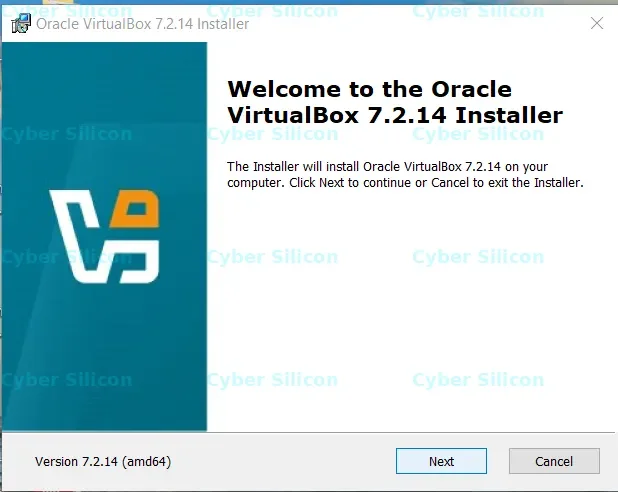

1. افتح ملف التثبيت الذي قمنا بتنزيله في الدرس السابق.
2. اضغط على **Next** ثم تابع الخطوات بالنقر على **Next** والتوافق على الخيارات الافتراضية.
3. اضغط على **Install** ثم **Yes** لمنح صلاحيات التثبيت.
4. عند اكتمال التثبيت، اضغط على **Finish** لفتح البرنامج تلقائياً.

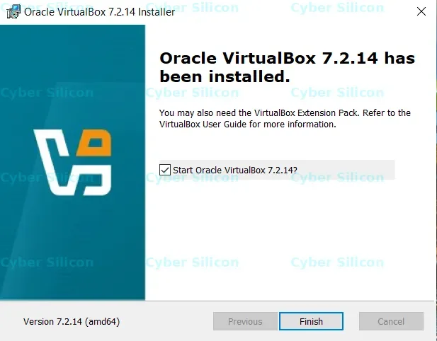

---

### 🧩 الخطوة 2: تثبيت حزمة الإضافات (Extension Pack)

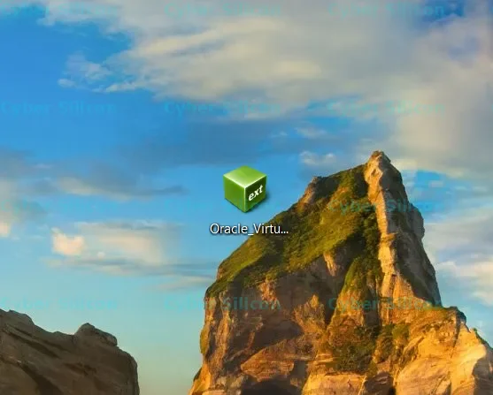

لضمان دعم منافذ USB والأداء الأفضل للشبكة والأجهزة الافتراضية:

1. اضغط مرتين على ملف حزمة الإضافات **VirtualBox Extension Pack** الذي قمنا بتنزيله سابقاً.
2. ستفتح نافذة داخل برنامج VirtualBox تنبهك لتثبيت الحزمة، اضغط على **Install**.

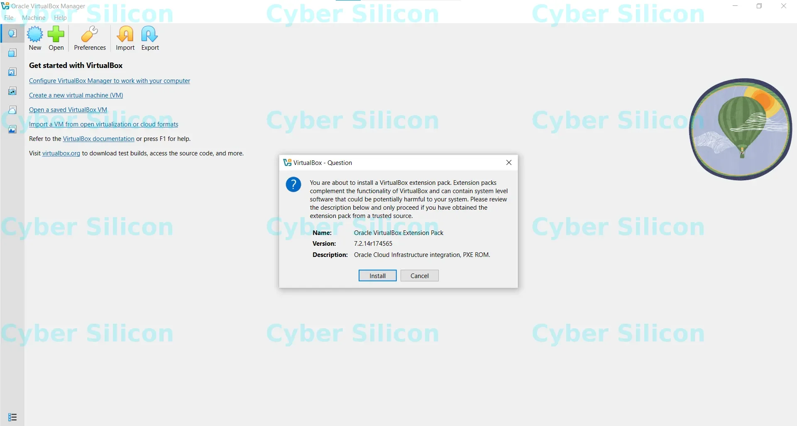

3. قم بالتمرير لأسفل وافق على الشروط بالنقر على **I Agree**.

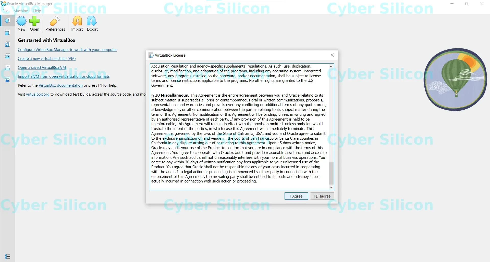

---

### 🖥️ الخطوة 3: إنشاء آلة وهمية جديدة (Create Machine)

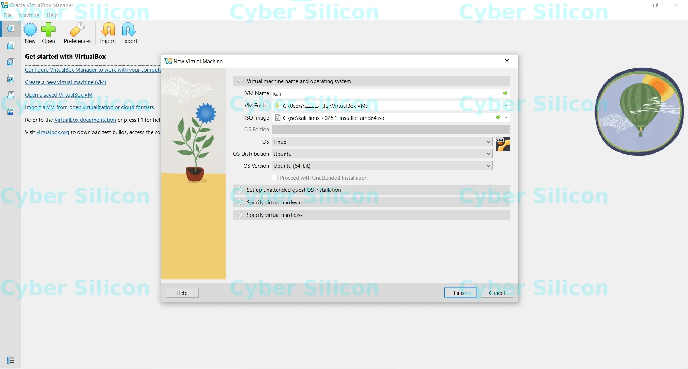

1. من الواجهة الرئيسية لبرنامج VirtualBox، اضغط على زر **New** (أو **Create a new virtual machine**).
2. في خانة **Name**، اكتب اسم الآلة الوهمية (مثلاً: `Kali`).
3. اختر مجلد الحفظ المطلوب في **Folder**.
4. . في خيار **ISO Image**، قم بتحديد مسار ملف نظام Kali Linux الذي قمت بتنزيله بصيغة `.iso`.

---

### 💿 الخطوة 4: تحديد الموارد (RAM, CPU, Disk)

1. حدد حجم الذاكرة العشوائية (**RAM**)؛ يُوصى بتحديد **2048 MB** (2GB) أو أكثر حسب مواصفات جهازك.
2. حدد عدد أنوية المعالج (**CPU cores**)؛ يُفضل اختيار **2 CPUs** على الأقل لضمان سلاسة التشغيل.

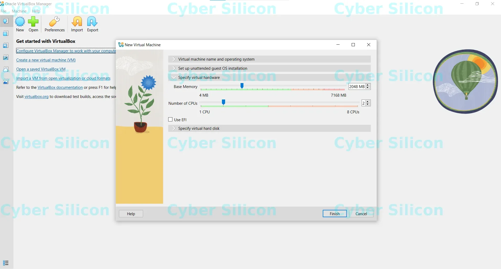

3. في إعدادات القرص الصلب (**Hard Disk**)، قم بتعديل مساحة الهارد الافتراضية الي **50GB** او **100GB** (أو أكثر حسب حاجتك)، ثم اضغط على **Finish**.

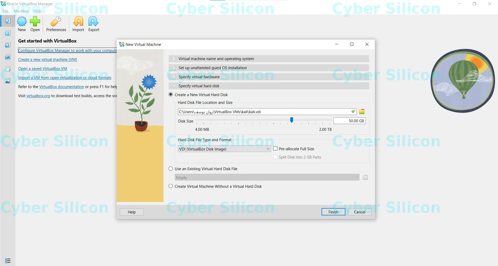

---

### 🌐 الخطوة 5: مراجعة إعدادات الشبكة (Network)

1. حدد الآلة الوهمية واضغط على **Settings** ثم انتقل إلى تبويب **Network**.
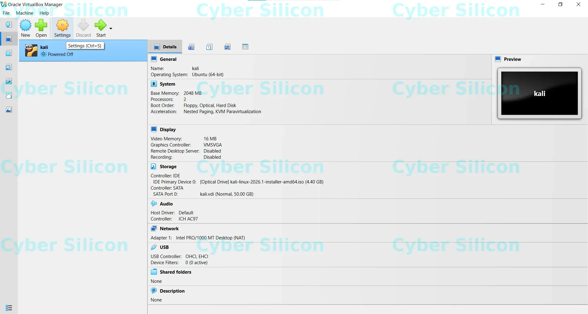

2. اترك الخيار على **NAT** ليتصل النظام الوهمي بالإنترنت عبر جهازك الأساسي تلقائياً.
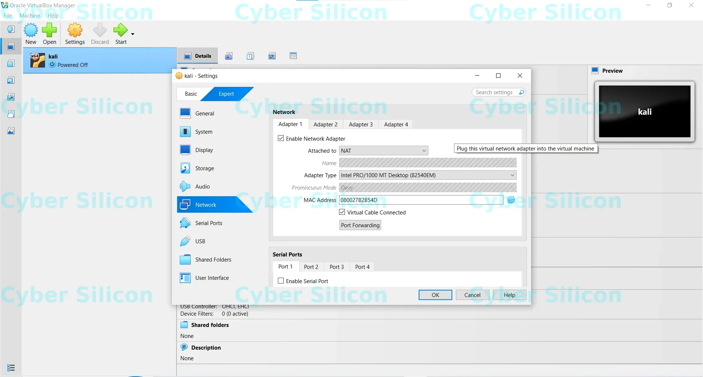

3. 💡 *ملاحظة:* إذا كان لديك كارت شبكة خارجي (Wi-Fi Adapter) وتريد ربطه بالمختبر مباشرة، يمكنك تغييره إلى **Bridged Adapter** واختيار الكارت الخاص بك، أو تركه كما هو للحصول علي الانترنت مؤقتا ولاحقا تستطيع تعديله.
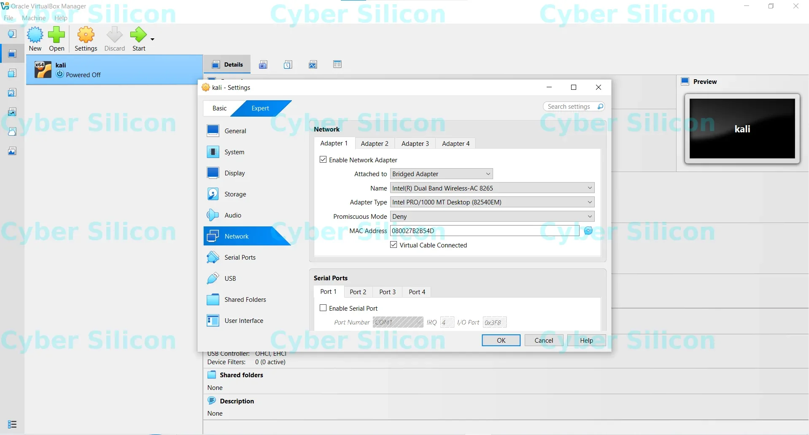

---

🔔 **في الدرس القادم:** سنشرح حرق النظام على الفلاشة للذين يريدون تثبيت النظام كـ Dual Boot بجانب الويندوز أو على حاسوب آخر بشكل مباشر للاستفاده من كرت الواي فاي الداخلي اذا كان يدعم وضع المراقبة ***(Monitor Mode)*** وحقن الحزم ***(Packet Injection)***!

---

### 🔗 التنقل بين دروس السلسلة

* **الدرس السابق 👈:** تلقائي
* **الدرس التالي 👈:** جاري إعداد الدرس الثالث...

<iframe src="https://www.tiktok.com/player/v1/7667112940985715989?autoplay=0" style="width:100%;max-width:340px;height:580px;border:none;border-radius:12px;" allow="fullscreen" loading="lazy"></iframe>

> 📹 **شاهد الشرح الكامل على TikTok:** [https://www.tiktok.com/@cyber_silicon/video/7667112940985715989?utm_campaign=tt4d_open_api&utm_source=sbawotogm6mg76anhw](https://www.tiktok.com/@cyber_silicon/video/7667112940985715989?utm_campaign=tt4d_open_api&utm_source=sbawotogm6mg76anhw)
